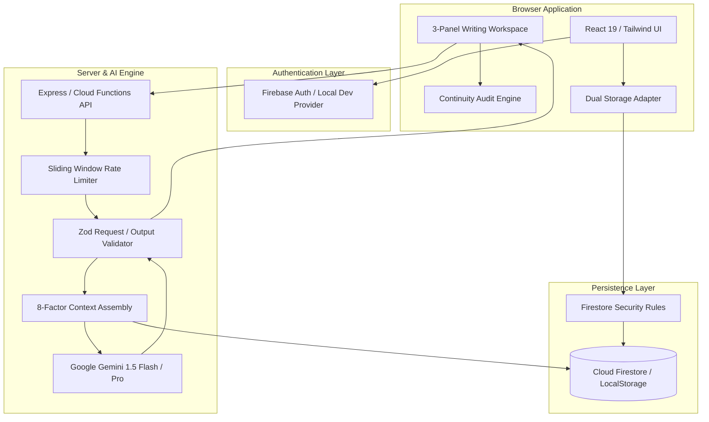

# STORYNEX — System Architecture

---

## 8-Factor Context Flow
1. **Story Premise:** Foundational universe reality and primary anomaly.
2. **Genre & Style:** Tone constraints (e.g. atmospheric, clipped, noir).
3. **Chapter Objective:** Dramatic goal of current scene.
4. **Cast Psychology:** Active characters' motivations, fears, and cadences.
5. **Previous Chapter Continuity:** Summary of previous chapter's events.
6. **3-Layer Memory:** Approved facts (Importance >= 3).
7. **Branch Context:** Current alternate decision choice.
8. **Author Directives:** Real-time steering instructions.

---

## Data Flow: Non-Destructive Reviewable Drafts
1. Author triggers generation.
2. AI synthesizes draft based on 8 factors.
3. Output is parsed into `{ title, content, summary, continuityNotes, unresolvedThreads }`.
4. Result is presented in the **Reviewable Draft Banner**.
5. Author chooses **Replace Chapter**, **Append to End**, or **Discard**.
6. Autosave debounces and persists the decision to Firestore.
